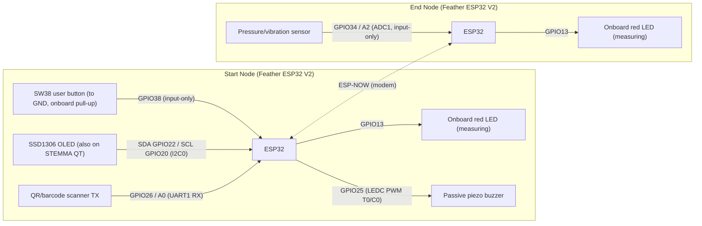

# Wiring

Pin map for the two timer nodes, as defined in
[`crates/firmware-start/src/board.rs`](crates/firmware-start/src/board.rs) and
[`crates/firmware-end/src/board.rs`](crates/firmware-end/src/board.rs).
Both nodes are Adafruit Feather ESP32 V2 boards linked over ESP-NOW.

Notes:

- UART0 is reserved for the USB-serial console on the start node.
- The scanner is unused in `camera` builds — the camera replaces it.

## Start node pins

| Function | GPIO | Notes |
| -------- | ---- | ----- |
| Trigger (SW38 user button) | 38 | Input-only; to ground when pressed, pull-up on board |
| Red LED | 13 | Onboard; on while measuring |
| OLED SDA | 22 | I2C0; also on STEMMA QT |
| OLED SCL | 20 | I2C0; also on STEMMA QT |
| Scanner RX | 26 (A0) | UART1; scanner TX wires here. Unused in `camera` builds |
| Buzzer | 25 | Passive piezo, LEDC PWM timer 0 / channel 0 |

## End node pins

| Function | GPIO | Notes |
| -------- | ---- | ----- |
| Pressure/vibration sensor | 34 (A2) | ADC1; input-only |
| Red LED | 13 | Onboard; on while measuring |

## Optional camera build (start node, `--features camera`)

| Signal | GPIO | Signal | GPIO |
| ------ | ---- | ------ | ---- |
| XCLK   | 32   | D3     | 25   |
| SCCB SDA | 26 | D2     | 33   |
| SCCB SCL | 27 | D1     | 15   |
| D7     | 36   | D0     | 14   |
| D6     | 39   | VSYNC  | 12   |
| D5     | 34   | HREF   | 21   |
| D4     | 4    | PCLK   | 5    |

PWDN and RESET are not connected (-1).
