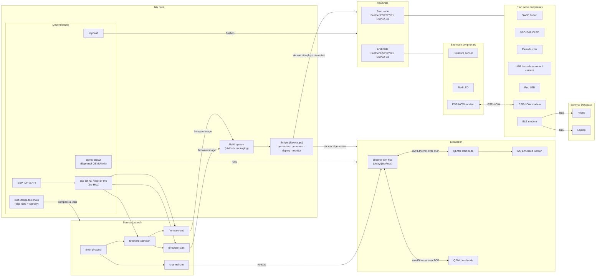

# esp-timer

Two-part wireless timer for ESP32. A **start node** (button, buzzer, player ID, screen)
and an **end node** (pressure/vibration sensor) are linked over ESP-NOW. The start node
syncs both clocks, timestamps the start, and reports the elapsed time when the end node
completes. All code is primarily written in Rust on ESP-IDF, targeting the Adafruit
Feather ESP32 V2 and the Feather TFT ESP32-S3 (see `board.rs` for wiring).

## Project layout

- `crates/firmware-start` — start node firmware: trigger button, 3-2-1-go buzzer cue,
  SSD1306 OLED screen (or the Feather TFT ESP32-S3's onboard ST7789), USB barcode player
  scanner (or camera), BLE score sync.
- `crates/firmware-end` — end node firmware: analog pressure sensor trigger, end-event
  broadcast.
- `crates/firmware-common` — shared drivers: radio link, triggers, sensor, display,
  buzzer, scanner, camera, scores, clock helpers.
- `crates/timer-protocol` — wire protocol (serde/postcard frames) and clock-sync math
  shared by both nodes.
- `crates/channel-sim` — host tool that links emulated nodes with configurable
  delay/jitter/loss (used only in simulation).
- `crates/firmware-common/components/esp32-camera` — vendored camera driver (git
  submodule; v2.0.15).
- `crates/firmware-common/components/esp-usb` — vendored Espressif USB stack (git
  submodule); the `usb_host_hid` class driver in it drives the barcode scanner.
  `components/usb_host_hid` is a thin wrapper around it.
- `nix/` — Nix packaging: firmware images, QEMU sim bundle, deploy scripts, toolchain
  overlays.
- `sdkconfig.defaults`, `rust-toolchain.toml`, `.cargo/config.toml` — ESP-IDF config,
  `esp` Rust toolchain, Xtensa target + `espflash` runner.

## How things connect

The Nix flake provies all tooling, build scripts, packaging, and deployment pipelines.

Provided dependencies:

- rust-xtense
- ESP-IDF v5.4.4
- qemu-esp32
- esp-idf-hal/svc

Provided tools:

- qemu-sim
- qemu-run
- deploy
- monitor

Built outputs:

- firmware images
- deploy scripts

## Building and running

There are multiple build pathes for the firmware images, including:

- esp32-v2 USB scanner
- esp32-s3 USB scanner
- QEMU (esp32)
- esp32-v2 camera
- esp32-s3 camera
- esp32-s3 onboard screen, USB scanner
- esp32-s3 onboard screen, camera

Both the firmware images and deploy scripts can be built directly in Nix from the flake.

To build the final firmwares used in the MVP:

- `nix run .#deploy-s3-tft-camera -- start [PORT]` for the start node
- `nix run .#deploy-default -- end [PORT]` for the end node

The `nix run .#monitor [PORT]` command may be used to reconnect a serial connection
should it be lost.

## Simulating

For running the simulation, use the `nix run .#qemu-sim [--gui]` command to open a
window to simulate the start screen. More options may be found with `--help`.

## Vendored dependencies

The only vendored dependency is `rqrr` due to minor code changes to fit onto the ESP32
