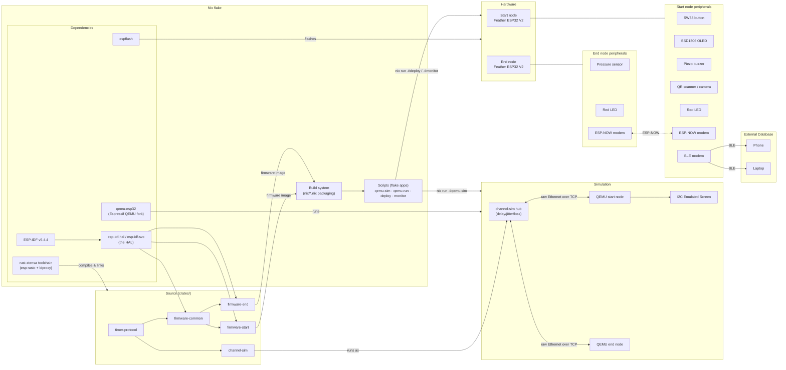

# esp-timer

Two-part wireless stopwatch for ESP32. A **start node** (button + buzzer countdown cue)
and an **end node** (pressure/vibration sensor) are linked over ESP-NOW; the start node
syncs both clocks, timestamps the start, and reports the elapsed time when the end node
fires. Written in Rust on ESP-IDF, targeting the Adafruit Feather ESP32 V2 (see
[PINS.md](PINS.md) for wiring).

## Project layout

- `crates/firmware-start` — start node firmware: trigger button, 3-2-1-go buzzer cue,
  OLED screen, QR/barcode player scanner (or camera), BLE score sync.
- `crates/firmware-end` — end node firmware: analog pressure sensor trigger, end-event
  broadcast.
- `crates/firmware-common` — shared drivers: radio link, triggers, sensor, display,
  buzzer, scanner, camera, scores, clock helpers.
- `crates/timer-protocol` — wire protocol (serde/postcard frames) and clock-sync math
  shared by both nodes.
- `crates/channel-sim` — host tool that links emulated nodes with configurable
  delay/jitter/loss (used only in simulation).
- `crates/firmware-common/components/esp32-camera` — vendored camera driver (git
  submodule).
- `nix/` — Nix packaging: firmware images, QEMU sim bundle, deploy scripts, toolchain
  overlays.
- `sdkconfig.defaults`, `rust-toolchain.toml`, `.cargo/config.toml` — ESP-IDF config,
  `esp` Rust toolchain, Xtensa target + `espflash` runner.

## How things connect

Everything is built by the Nix flake: it provides the Espressif `esp` Rust toolchain
(Xtensa rustc + `ldproxy`), ESP-IDF v5.4.4, the QEMU ESP32 fork, and `espflash`, and it
vendors the crates.io dependencies (`esp-idf-svc`/`esp-idf-hal`, `esp32-nimble`,
`serde`/`postcard`, …) so sandboxed builds work offline. The runnable entry points are
packaged as flake apps (`qemu-sim`, `qemu-run`, `deploy`, `monitor`) with all store
paths baked in. The same firmware crates build for both targets: hardware (ESP-NOW link,
GPIO triggers) and `--features qemu` (raw Ethernet link, virtual triggers), so the HAL
is used in both.

## Building and running

- Dev shell: `nix develop` (or `direnv allow`), then `cargo build -p firmware-start` /
  `-p firmware-end`.
- Hardware: `nix run .#deploy` flashes a node over USB with `espflash`;
  `nix run .#monitor` opens the serial monitor. Inside the dev shell,
  `cargo run -p firmware-start` flashes + monitors directly.
- Simulation: `nix run .#qemu-sim` runs both nodes in QEMU connected by `channel-sim`.
  The QEMU build (`--features qemu`) swaps ESP-NOW for raw Ethernet and the physical
  triggers for virtual ones.
